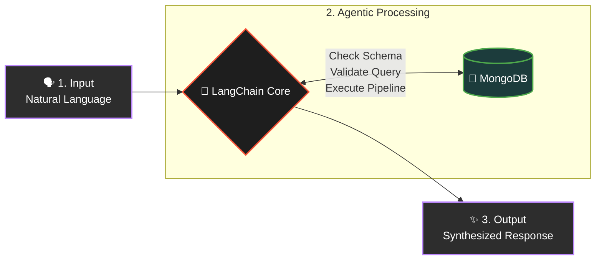

<div align="center">

# QueryNest 🪶
**A Practical Agentic Interface for MongoDB**

<p align="center">
  <a href="https://streamlit.io/"></a>
  <a href="https://python.langchain.com/"></a>
  <a href="https://www.mongodb.com/"></a>
  <a href="https://groq.com/"></a>
</p>

> *QueryNest is a continuous work in progress, serving as a practical template and learning ground for building, debugging, and understanding AI agents.*

</div>

---

## 📖 Overview

QueryNest is a simple, conversational web interface that allows users to interact with a MongoDB database using natural language. Built as an open practice ground for understanding **agentic architectures**, it bridges the gap between raw database logic and human conversation. It's designed to be a helpful, humble starting point for anyone looking to build robust database-querying agents without over-engineering.

<br>

## 🛠️ Architecture & Data Flow

QueryNest abstracts complex database interactions into a clean, three-step pipeline. By utilizing a **ReAct (Reasoning and Acting)** loop powered by LangChain, the application ensures that the LLM interacts with your database safely, predictably, and transparently.



### 🧩 The Pipeline Explained
| Stage | What Happens Under the Hood | Technology |
| :--- | :--- | :--- |
| **1. Input** | The user asks a plain English question via the frontend. The application captures the query and securely passes it to the agent along with the database credentials. | `Streamlit` |
| **2. Processing** | The agent reasons about the request. It uses specialized tools to actively browse the database collections, draft a safe MongoDB aggregation pipeline, validate its syntax, and execute it against the database. | `LangChain` & `MongoDB` |
| **3. Output** | The LLM receives the raw JSON results from the database, synthesizes the data into human-readable text, and streams it back to the user interface alongside its thought process. | `Groq` |

<br>

## 🚀 Getting Started

### 📋 Prerequisites
Before you begin, ensure you have the following:
- **Python 3.9+** installed on your system.
- A **Groq API Key** (You can generate one at [console.groq.com](https://console.groq.com)).
- A **MongoDB Cluster / Database URI** (e.g., via MongoDB Atlas).

### ⚙️ Setup Instructions

**1. Clone the repository:**
```bash
git clone https://github.com/yourusername/QueryNest.git
cd QueryNest
```

**2. Set up a virtual environment (Recommended):**
Keep your dependencies isolated to avoid conflicts.
```bash
python3 -m venv .venv
source .venv/bin/activate  # On Windows use: .venv\Scripts\activate
```

**3. Install the dependencies:**
Install all required packages cleanly via the provided `requirements.txt`.
```bash
pip install -r requirements.txt
```
*(Note: Streaming logic is handled safely and natively in the main thread via Streamlit's `st.status`, avoiding common threading issues in LangChain callbacks).*

**4. Run the application:**
```bash
streamlit run app.py
```

<br>

## 💡 Usage Flow

1. 🔐 **Configure:** Upon launching the UI, open the sidebar and securely input your `GROQ_API_KEY`, your `MONGODB_URI`, and the target `Database Name`.
2. 🔌 **Connect:** Click **Connect**. The app will initialize the LangChain MongoDB toolkit and establish a secure connection.
3. 💬 **Chat:** Start asking questions about your data! Try prompts like:
   - *"How many users do we have in total?"*
   - *"List the top 5 users based on their listening time."*
4. 🔍 **Observe the Agent:** Click the **"Agent thinking..."** dropdown in the chat to look under the hood. You'll see exactly how the model reasons, which tools it selects, and the raw output it receives from MongoDB before giving you the final human-readable answer.

---
<div align="center">
  <sub>Built for the love of AI engineering and exploring agentic logic.</sub>
</div>
