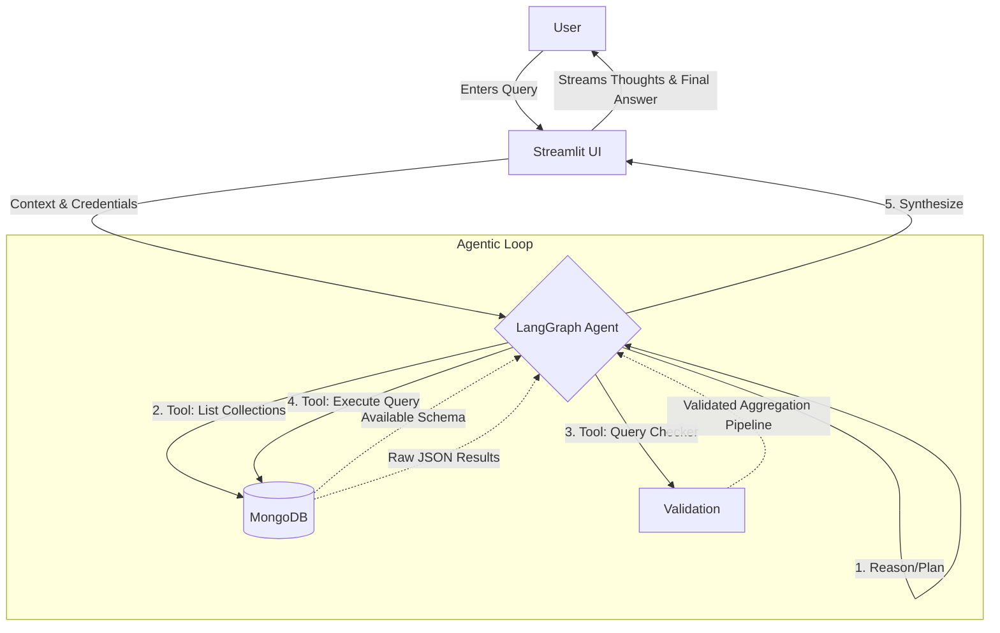

# 🦜 QueryNest

QueryNest is a practical exploration into building agentic applications. It is a simple, conversational web interface that allows users to interact with a MongoDB database using natural language. 

Built as a practice ground for understanding agent patterns, it uses Streamlit for the frontend, LangChain/LangGraph for the agent orchestration, and Groq for the LLM inference. It's designed to be a helpful, humble starting point for anyone looking to build database-querying agents.

## 🛠️ Architecture & System Design

QueryNest follows a standard ReAct (Reasoning and Acting) agent pattern implemented via LangGraph. 

Here is a high-level overview of the System Design and Data Flow:



### Components
1. **Frontend (Streamlit):** Handles user inputs, securely stores database URIs and API keys in session state, and streams the agent's thought process (tool calls and reasoning) in real-time.
2. **Agent Core (LangGraph):** A `create_agent` wrapper orchestrates the flow. It parses the user query, decides which tool to use, and recursively evaluates the tool's output until it has enough information to answer the user.
3. **Tools (MongoDB Database Toolkit):** 
   - *List Collections:* Checks what tables exist.
   - *Query Checker:* Validates the syntax of the MongoDB aggregation pipeline to prevent runtime crashes.
   - *Query Executor:* Runs the `db.collection.aggregate(...)` pipeline against the actual database.
4. **LLM Engine (Groq):** Provides the reasoning layer (e.g., `gpt-oss-20b` or `Llama3`) to translate plain English into valid MongoDB pipelines and synthesize the raw JSON output back into human-readable text.

## 🚀 Getting Started

### Prerequisites
- Python 3.9+
- A Groq API Key (get one at [console.groq.com](https://console.groq.com))
- A MongoDB cluster/database URI 

### Setup Instructions

1. **Clone the repository:**
   ```bash
   git clone https://github.com/yourusername/QueryNest.git
   cd QueryNest
   ```

2. **Set up a virtual environment:**
   It is best practice to use a virtual environment to keep dependencies isolated.
   ```bash
   python3 -m venv .venv
   source .venv/bin/activate  # On Windows: .venv\Scripts\activate
   ```

3. **Install the dependencies:**
   Install all required packages via the provided `requirements.txt`.
   ```bash
   pip install -r requirements.txt
   ```
   *(Note: If you run into any Langchain community callback errors, the app handles streaming natively via `st.status`.)*

4. **Run the application:**
   ```bash
   streamlit run app.py
   ```

## 💡 Usage Flow

1. **Configure:** Upon launching, use the sidebar to securely input your `GROQ_API_KEY`, your `MONGODB_URI`, and the specific `Database Name`.
2. **Connect:** Click "Connect". The app will initialize the database toolkit.
3. **Chat:** Ask questions about your data! Examples:
   - *"How many users do we have?"*
   - *"List the top 5 users based on their listening time."*
4. **Observe the Agent:** Expand the "Agent thinking..." box in the chat to see exactly how the model reasons, which tools it selects, and the raw output it receives from MongoDB before giving you the final answer.

---
*QueryNest is a continuous work in progress, serving as a practical template for building and understanding AI agents.*
